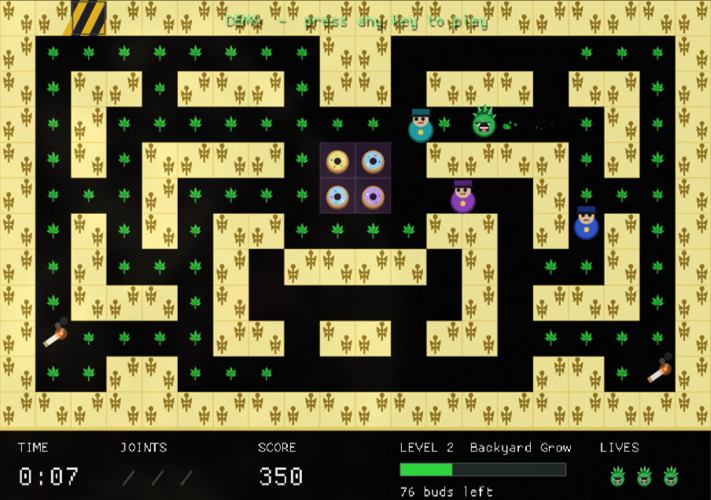

# Giddy Ganja

A cartoon cannabis arcade maze for adults. You are a happy little pot leaf.
Gather every bud, light a joint to cloud the cops in smoke, and slip out the
exit before the police (and their donut habit) catch up. Written from scratch
in Rust with [macroquad](https://macroquad.rs); runs on Linux, Windows and macOS.

Comedic and cartoonish only: there is nothing instructional in it.



## Play

```
cargo run --release
```

Linux needs the ALSA and X11/GL development headers
(`libasound2-dev libx11-dev libxi-dev libgl1-mesa-dev` on Debian/Ubuntu,
`alsa-lib libx11 libxi mesa` on Arch).

| Action | Keys |
|---|---|
| Move | Arrow keys / WASD (touch: swipe) |
| Light a joint | Space (touch: two-finger tap) |
| Pause | P |
| Fullscreen | F11 |
| Volume / mute | 0-7 / M |

## Rules

- Eat every bud (10 points), then reach the exit at the top of the maze.
- Pick up joints (up to 3). Lighting one clouds every cop in range for five
  seconds. Touch a dazed cop to send them back to the donut shop for
  100, 200, 400, 800 points in a chain.
- Beat the par time for a bonus; an extra life every 5000 points.
- Cops use four different chase personalities, never stand still, and speed up
  when few buds remain.
- 4 hand-made levels, then endless generated mazes.

Options include speed, stop-on-release steering, lives, and a Classic/Modern
look. Flags: `--demo [level]` (autopilot), `--level N`.

## Develop

`cargo test` runs the headless logic suite (movement, cop AI, level validity,
an autopilot that clears levels).

## Inspiration

Inspired by *The Adventures of Happyweed!* (1993, Christopher B. Council).
This is an independent re-creation of the general idea: all code, art, sound
and levels here are original, and this project is not affiliated with the
original.

## License

MIT
