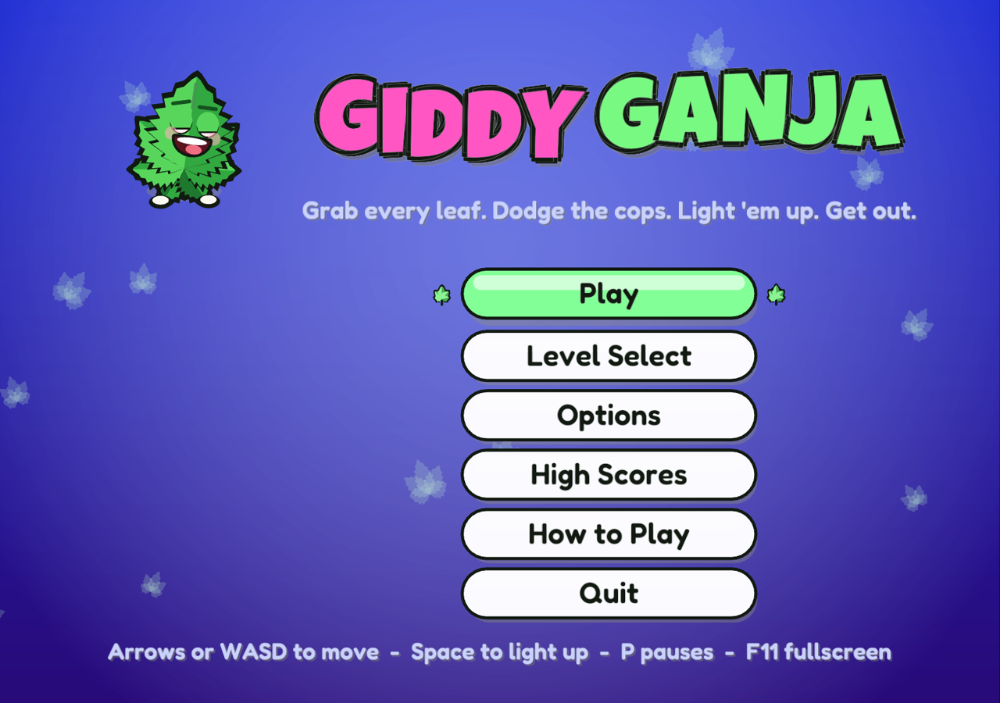
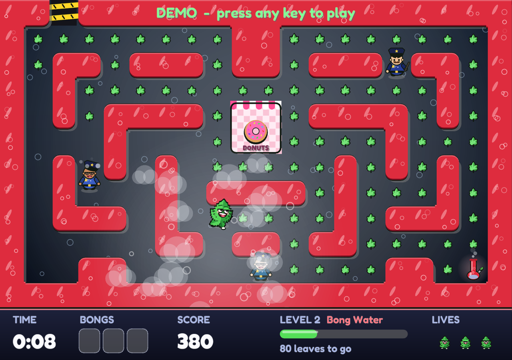
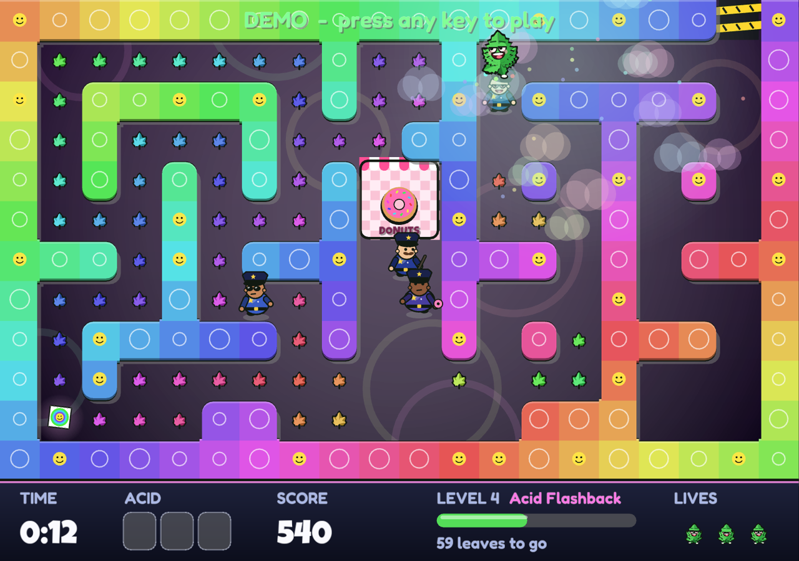

# Giddy Ganja

A cartoon cannabis arcade maze for adults. You are Giddy, a happy little pot leaf. Grab every
leaf in the maze, pick up the level's stash and light it up to smoke out the cops, then slip
out the exit before the police (and their donut habit) catch up. Written from scratch in Rust
with [macroquad](https://macroquad.rs); runs on Linux, Windows and macOS.

Comedic and cartoonish only: there is nothing instructional in it.







## Every level has its own stash

| Level | Place | Stash |
|---|---|---|
| 1 | Rolling Papers | joints |
| 2 | Bong Water | red bongs |
| 3 | The Golden Bowl | gold pipes |
| 4 | Acid Flashback | acid tabs |
| 5 | Shroom Grove | magic mushrooms |
| 6 | Hookah Lounge | hookahs |
| 7 | Pot Brownie Bakery | pot brownies |
| 8 | Blunt Force | blunts |
| 9 | Peyote Desert | peyote buttons |
| 10 | Space Cake | space cakes |

After that the themes come round again (Rolling Papers 2, ...) with new mazes and faster cops,
forever.

## Play

```
cargo run --release
```

Linux needs the ALSA and X11/GL development headers
(`libasound2-dev libx11-dev libxi-dev libgl1-mesa-dev` on Debian/Ubuntu,
`alsa-lib libx11 libxi mesa` on Arch).

| Action | Keys |
|---|---|
| Move | Arrow keys / WASD (touch: swipe) |
| Light a joint | Space (touch: two-finger tap) |
| Pause | P |
| Fullscreen | F11 |
| Volume / mute | 0-7 / M |
| Music on/off | N |

## Rules

- Grab every leaf (10 points), then reach the exit at the top of the maze.
- Pick up the level's stash (up to 3). Lighting one up clouds every cop within
  six tiles: 10 seconds on level 1, half a second less each level, never under
  6. A bar at the top and a ring over each dazed cop count it down; in the last
  three seconds they flash and tick. Bump a dazed cop to send them back to the donut shop for
  100, 200, 400, 800 points in a chain.
- Beat the par time for a bonus; an extra life every 5000 points.
- The cops think like Pac-Man ghosts: at each junction they head the way that
  looks closest to their target, never turn back on their own, and take turns
  chasing you and wandering off to their home corners. Each has a personality
  (one hunts you, one cuts you off, one flanks, one loses interest up close).
  They never stand still, and they speed up when few leaves remain.
- No dead ends, ever: like Pac-Man, you can always keep running.
- 4 hand-made mazes, then endless generated ones.

Options include speed, volume, stop-on-release steering and fullscreen.
Flags: `--demo [level]` (watch the autopilot), `--level N`,
`--shot FILE SECONDS` (save a screenshot and quit).

## Develop

`cargo test` runs the headless logic suite: movement, cop AI (never idle, no
U-turns), level validity and no dead ends, and an autopilot that clears levels.
All art is drawn from shapes at runtime and all sound is synthesized at startup,
including the music: an acid rave for playing, a chill-out version for the
menus, and a dubstep drop (wobbles, growls, screeches) that takes over while the
cops are smoked out. There are no image or audio files.

## Inspiration

Inspired by *The Adventures of Happyweed!* (1993, Christopher B. Council).
This is an independent re-creation of the general idea: all code, art, sound
and levels here are original, and this project is not affiliated with the
original.

## License

The code is MIT. The bundled fonts keep their own licences:
[Luckiest Guy](assets/fonts/LuckiestGuy-LICENSE.txt) (Apache 2.0, by Astigmatic) and
[Fredoka](assets/fonts/Fredoka-OFL.txt) (SIL Open Font License 1.1), both subset to Latin.
